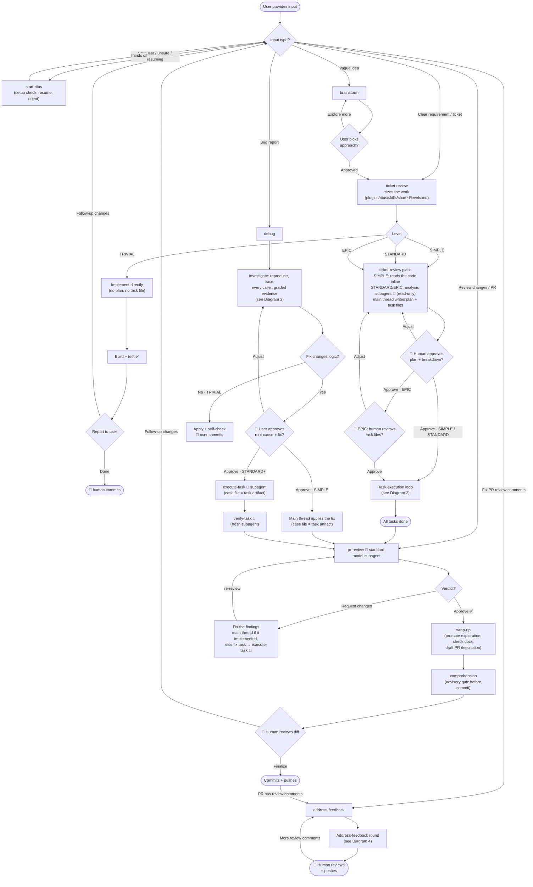
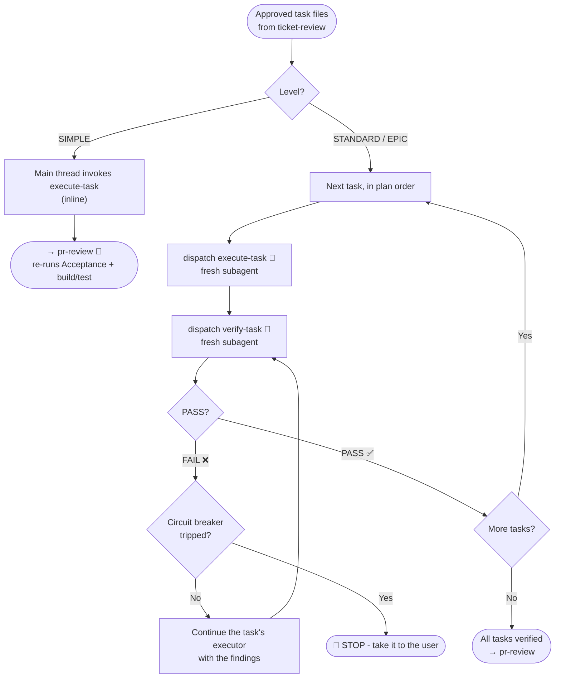
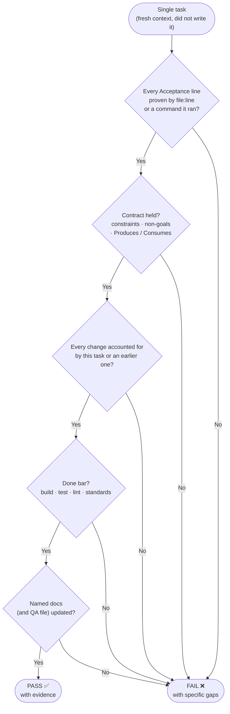
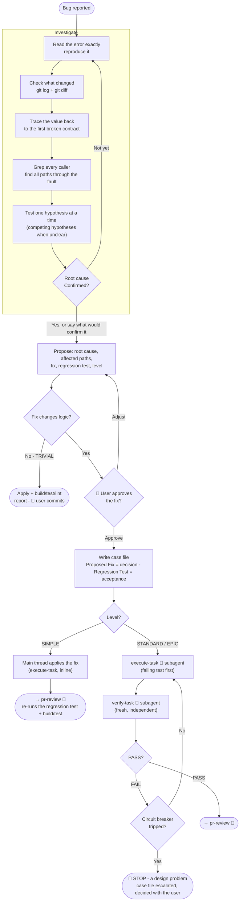
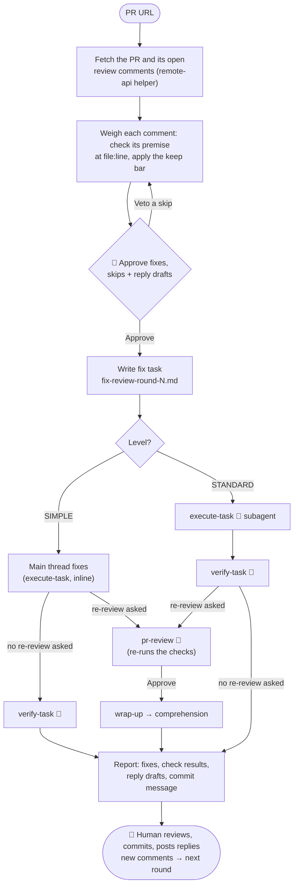
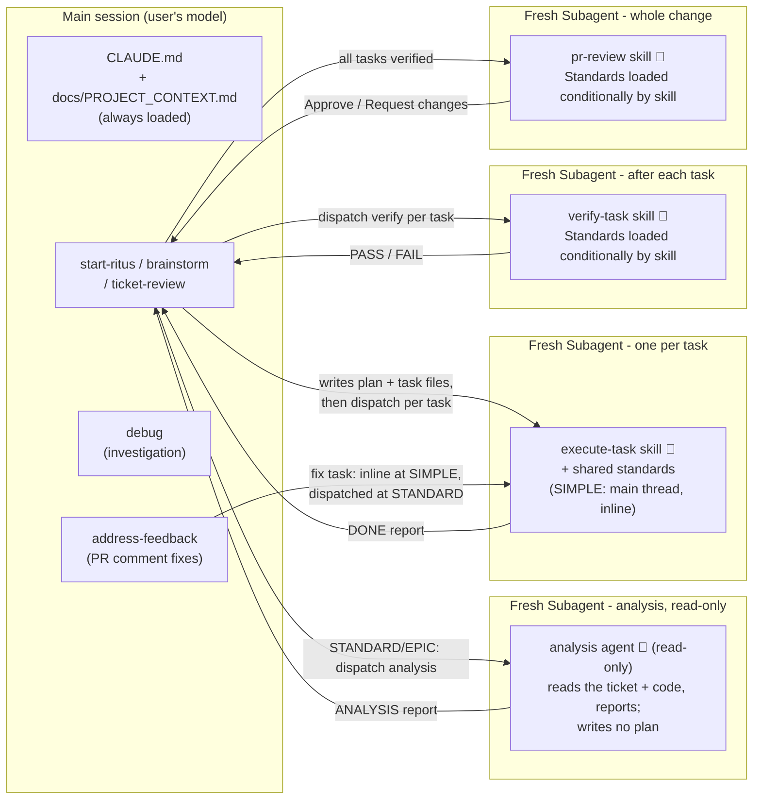
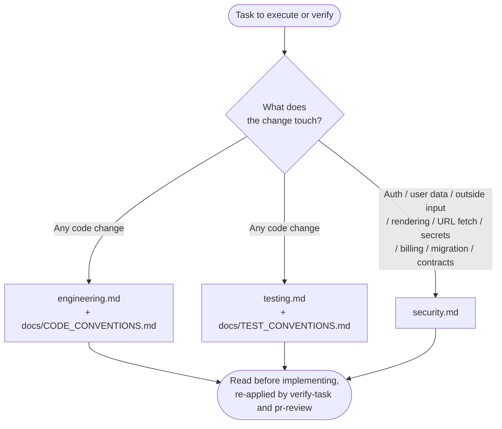
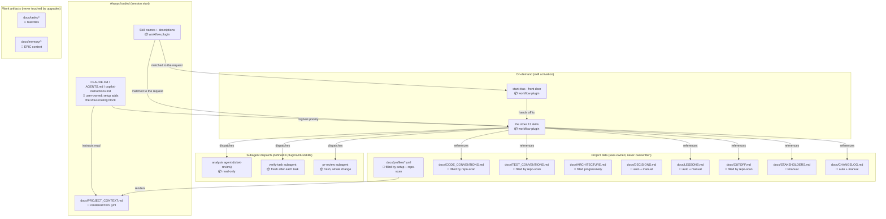

# Workflow Diagrams

> **AI agents: do NOT read this file during workflow execution.** These diagrams are for human
> onboarding and reference only. The authoritative process lives in the skill files - follow those.

Visual reference for the Ritus workflow process. All diagrams use Mermaid syntax.

## 1. Main Workflow

Entry points, levels, and the path to completion.

**Legend:** 🧑 = human-in-the-loop gate. 🤖 = runs as a dedicated subagent.

## 2. Task Execution Loop

The execute → verify cycle: one task at a time, with a bounded fix loop.

### Verify-task detail (per task)

## 3. Debug Investigation Flow

Find the cause before changing anything, then size the fix: a fix that adds no logic goes straight in, anything else
waits for the user.

## 4. Address-Feedback Round

Weigh each review comment against the code, get one approval for the fixes and the skips, fix, check independently,
then hand the user the diff, the reply drafts, and a commit message.

**Legend:** 🧑 = human-in-the-loop gate. 🤖 = runs as a dedicated subagent.

## 5. Context Architecture

What runs in which context. Every subagent runs on the model the platform gives it - the session model unless the user
configured subagents otherwise; Ritus doesn't pick models (`plugins/ritus/skills/shared/dispatch.md` "Models").

## 6. Standards Loading Matrix

Which shared standards (`plugins/ritus/skills/shared/standards/`) apply to which work. They are plain docs the workers
read, not skills.

## 7. File Ownership and Loading

What loads when, and who owns each file.

**Legend:** 🧑 user-owned (preserved on upgrade) · 📦 workflow package (replaced on upgrade) · 🔄 rendered · 📝 work artifacts
